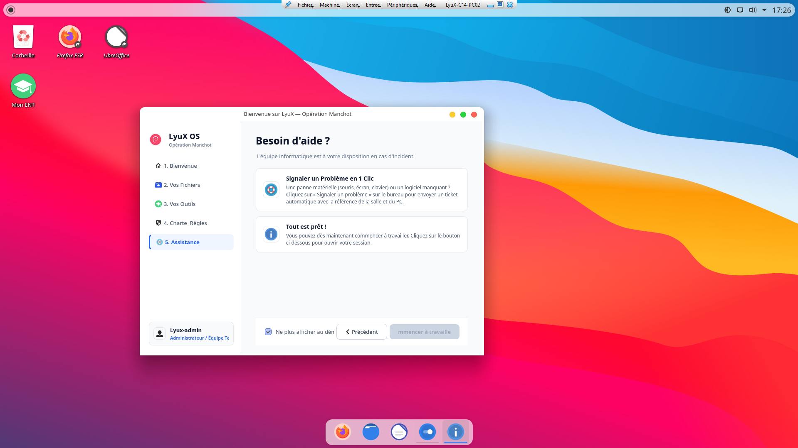

# 🖥️ LyuX Desktop (`lyux-desktop`)

Ce sous-dossier regroupe toutes les configurations graphiques, thèmes et règles de sécurisation des postes clients sous **Debian 13 (Trixie) & KDE Plasma 6**.

## 📘 Documentation

> 📚 **Documentation complète → [wiki `lyux-desktop`](https://github.com/Luux-Manchot/lyux-desktop/wiki)** : applications, création de poste, compatibilité logicielle, déploiement en salle, dépannage console (TTY).

- [Méthode de build du client](https://github.com/Luux-Manchot/lyux-os-builder/blob/master/docs/METHODE_BUILD_CLIENT.md) — Debian + KDE, Ansible, capture master, overlay ISO *(doc build : repo `lyux-os-builder`)*.
- [Créer un poste](https://github.com/Luux-Manchot/lyux-desktop/wiki/Creer-un-poste-client) — procédure pas-à-pas de l'ISO à la machine installée, vérifications et dépannage.
- [Logiciels et compatibilité](https://github.com/Luux-Manchot/lyux-desktop/wiki/Logiciels-et-compatibilite) — matrice Windows → Linux et alternatives retenues.

## Applications

[`applications/`](applications/README.md) regroupe les logiciels des postes clients, nommés sans préfixe `lyux-` : `welcome/`, `station/`, `report/` et `enrollment/`. `lyux-cli` a été supprimé (inutilisé).

## Composants
- `dolphin/` :
  - `99-hide-internal-disks.rules` : Règle Udev (`UDISKS_IGNORE="1"`) pour masquer `sda1` et les disques internes dans le gestionnaire de fichiers.
  - `10-udisks2-block-internal.rules` : Règle Polkit interdisant le montage des volumes système aux élèves et enseignants.
  - `user-places.xbel` : Raccourcis réseaux éducatifs préconfigurés (*Ma Classe*, *Casiers d'échange & Devoirs*).
- `sddm/` :
  - Thème épuré (Nom d'utilisateur + Mot de passe uniquement, liste des utilisateurs masquée).
- `plasma-kiosk/` :
  - Verrouillage de la configuration KDE et personnalisation du bureau élève.
