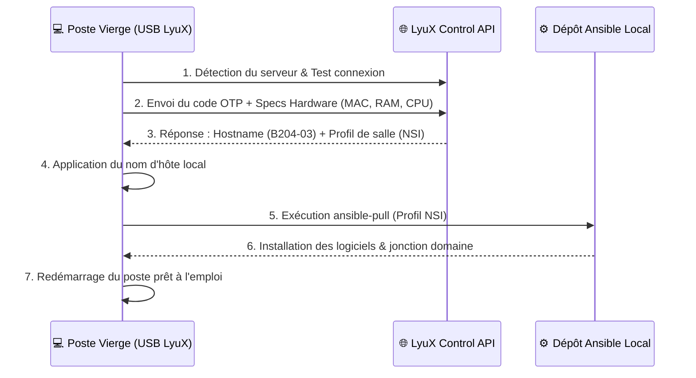

# ⚡ LyuX Enrollment
> **Assistant d'enrôlement et d'initialisation de machine par clé USB minimale ou démarrage réseau PXE.**

`enrollment` est le point d'entrée exécuté lors du premier démarrage d'un poste vierge (ou réinstallé). La clé USB ne contient presque rien : c'est le serveur LyuX de l'établissement qui lui dicte son identité, ses droits et ses logiciels.

> Chemin historique : le nouvel installateur autonome (`lyux-installer.sh`) enrôle directement via `POST /api/v1/parc/enroll`. Ce module reste utile pour l'ancien flux preseed/Calamares.

---

## 🔄 Déroulement de l'enrôlement (Annexe A.2)



---

## 🚀 Utilisation & Test Manuel

```bash
cd lyux-desktop/applications/enrollment
pip install -r requirements.txt
python src/enroll.py --server http://192.168.100.10:8000 --otp LYUX-DEMO-2026 --room B204
```

---

## 📂 Structure

```
enrollment/
├── requirements.txt            # Dépendances (requests, rich/colorama)
├── systemd/
│   └── lyux-enrollment.service # Service de démarrage automatique sur l'ISO
├── src/
│   ├── enroll.py               # Script principal d'enrôlement
│   └── hardware.py             # Collecte des adresses MAC, RAM et CPU
└── README.md
```
